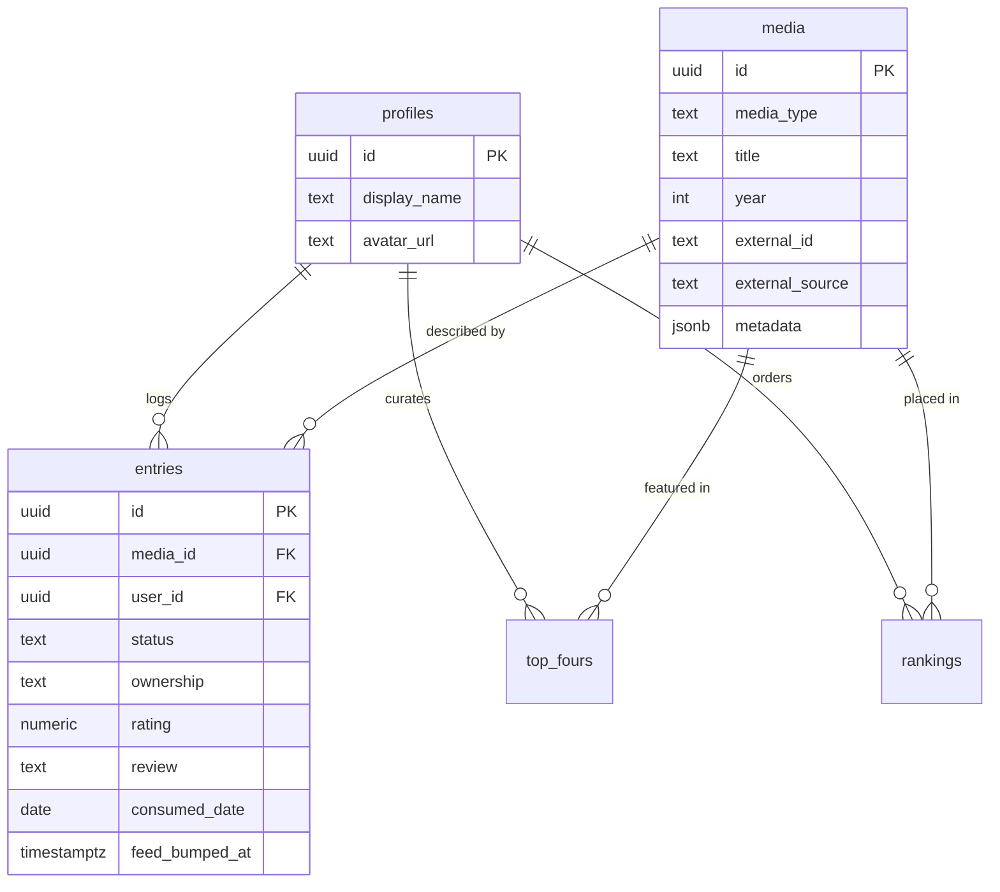

# Ourchive

**A shared media diary for a small group of friends — Letterboxd for everything.**

[](https://ourchive.xyz)
[](https://react.dev)
[](https://www.typescriptlang.org)
[](https://supabase.com)
[](https://vite.dev)

Letterboxd tracks films. Goodreads tracks books. Discogs tracks records. My friends and I
were spread across all three and still texting each other screenshots. Ourchive is the
version I wanted: **one place to log everything you watch, read, and listen to, and one feed
to see what everyone else is on.**

It's deliberately small and private — a closed archive for me and a handful of friends,
not a social network. That constraint is the point, and it shows up in the design: no
follower graph, no algorithmic ranking, no discovery surface. Everyone sees everyone.

<!-- Screenshots: drop images in docs/ and reference them here, e.g.

-->

---

## What it does

**Log anything.** Search once, across every media type at the same time. One query hits
The Movie Database, Open Library, and MusicBrainz in parallel and returns blended results,
so "Dune" surfaces the films, the novel, and the soundtrack together — with a badge showing
which of your friends already logged each one.

**Track state, not just stars.** Every entry carries a status (want / in progress /
completed / did not finish), an ownership state (don't own / want to own / own physical /
own digital), a half-star rating, a review, and a consumed date. The ownership axis is
separate from the status axis on purpose: owning a record and having listened to it are
different facts, and a wishlist is not a backlog.

**Per-type behavior from one config.** Media types don't share a UI by accident — they
share it by configuration. A single `MEDIA_CONFIG` map drives which statuses, ownership
options, default values, and call-to-action buttons each type gets, so records skip the
status axis entirely (you own a record or you want it) while films get the full set.
Adding a new media type is a config entry plus a search adapter, not a new set of screens.

**A feed that isn't noisy.** The home feed is ordered by a dedicated `feed_bumped_at`
column rather than `updated_at`, and it only bumps on events that a human would actually
care about — moving something off the wishlist, or going from "want to own" to owning it.
Fixing a typo in a review doesn't resurface a three-year-old entry.

**Rank and curate.** A drag-and-drop ranked list per media type, plus a Letterboxd-style
"top four" grid on every profile.

**See the shape of your taste.** Per-type dashboards render status splits, rating
distribution, top genres with average rating, ownership breakdown, and activity over time.

**Bring your history with you.** A Letterboxd CSV importer ingests `ratings.csv`,
`reviews.csv`, `watched.csv`, and `watchlist.csv`, resolves each row against TMDB, and
reports a per-row outcome so you can see exactly what matched and what didn't.

---

## Tech stack

| Layer | Choice | Why |
| --- | --- | --- |
| UI | React 19, TypeScript, Vite | Fast iteration, strict types across the data layer |
| Styling | Tailwind CSS v4, Radix primitives | Accessible, unstyled primitives; no component-library lock-in |
| Server state | TanStack Query | Caching, deduping, and optimistic updates without a store |
| Backend | Supabase (Postgres, Auth, Row Level Security) | Real database and real auth without running servers |
| Interactions | dnd-kit, Recharts, date-fns | Drag-to-rank, dashboards, date handling |
| Hosting | GitHub Pages via GitHub Actions | Static build, zero cost, deploy on push to `main` |

There is no backend service. The client talks directly to Postgres through Supabase, and
**Row Level Security is the authorization layer** — every table enables RLS, reads are open
to authenticated members, and writes are constrained to `auth.uid() = user_id`. Security
lives in the database, not in application code that a bug could route around.

---

## Data model



The central decision is the **split between `media` and `entries`**. `media` is shared,
canonical metadata for a title — deduplicated across the whole group by a partial unique
index on `(external_id, external_source)`. `entries` is one user's relationship with that
title, unique on `(media_id, user_id)`.

Because of that split, when four people log the same album there is exactly one `media`
row, and the app can cheaply answer "who else has this?" — the query behind the friend
badges in search results. It also means a cover-art fix or a metadata correction lands for
everyone at once.

---

## Engineering notes

A few problems here were more interesting than the feature list suggests:

**Blended search across three APIs with different failure modes.** TMDB is fast and
authenticated; Open Library is slow and unauthenticated; MusicBrainz rate-limits
aggressively and wants a custom User-Agent. The search hook fires all four queries with
`Promise.allSettled` and takes the top few from each, so a MusicBrainz timeout degrades to
"no records in these results" rather than an empty page. Queries are debounced at 400ms and
cached for five minutes, with previous results held as placeholder data so the list doesn't
flash empty between keystrokes.

**A hand-written CSV parser.** Letterboxd's `reviews.csv` contains newlines inside quoted
fields, which a naive line-splitting parser corrupts silently — you don't get an error, you
get truncated reviews. The importer implements RFC 4180 quote handling as a character-level
state machine, then normalizes ratings across the two scales Letterboxd has exported over
the years and strips the HTML it wraps reviews in. The import loop paces itself at 350ms
per row to stay inside TMDB's rate limit, supports cancellation via `AbortSignal`, and
preserves `feed_bumped_at` on re-import so bulk imports don't flood everyone's feed.

**Ranking as a single atomic replace.** Reordering a drag-and-drop list by patching
individual positions invites drift and conflicts. Instead, saving a ranking deletes the
list for that `(user, media_type)` and reinserts it with positions `0..n-1`, which makes
"the order shown is the order stored" true by construction.

---

## Running it locally

**Prerequisites:** Node 20+, a [Supabase](https://supabase.com) project, and a free
[TMDB API key](https://www.themoviedb.org/settings/api). Open Library and MusicBrainz need
no credentials.

```bash
git clone https://github.com/DevonDrimmie/Ourchive.git
cd Ourchive
npm install
cp .env.example .env.local
```

Fill in `.env.local`:

```bash
VITE_SUPABASE_URL=https://your-project.supabase.co
VITE_SUPABASE_ANON_KEY=your-anon-key
VITE_TMDB_API_KEY=your-tmdb-key
```

Apply the schema by running the files in `supabase/migrations/` in order against your
project (the Supabase SQL editor works fine). They create the tables, RLS policies, and the
trigger that provisions a profile on signup. Then:

```bash
npm run dev
```

The app detects missing Supabase credentials and renders a setup screen instead of failing
at runtime.

| Command | Description |
| --- | --- |
| `npm run dev` | Start the Vite dev server |
| `npm run build` | Type-check with `tsc -b` and build for production |
| `npm run preview` | Serve the production build locally |

---

## Deployment

Pushing to `main` triggers a GitHub Actions workflow that builds with secrets injected as
Vite environment variables and publishes to GitHub Pages, served from `ourchive.xyz`. A
`404.html` fallback handles client-side routing on Pages. No secrets are committed —
`.env` and `.env.local` are gitignored, and only `.env.example` is tracked.

---

## Status and roadmap

Live and in daily use by its intended audience. Currently ships **films, books, records,
and games**; the schema, routing, and UI config are structured so a new type is additive
rather than a refactor.

- [x] **Video games** via the IGDB API
- [ ] Podcasts and comics
- [ ] Goodreads and Discogs importers, matching the Letterboxd one
- [ ] Comments and reactions on entries
- [ ] Year-in-review recaps

---

## Acknowledgements

Metadata and cover art come from [The Movie Database](https://www.themoviedb.org/),
[Open Library](https://openlibrary.org/), and
[MusicBrainz](https://musicbrainz.org/) / [Cover Art Archive](https://coverartarchive.org/).
This product uses the TMDB API but is not endorsed or certified by TMDB.

---

Built by [Devon Drimmie](https://github.com/DevonDrimmie).
